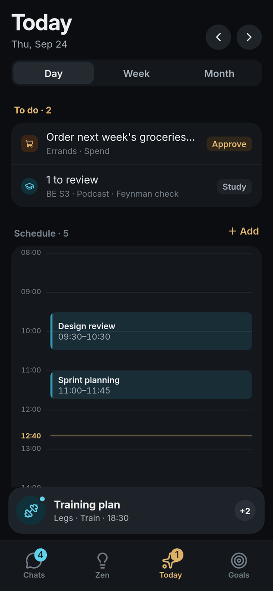
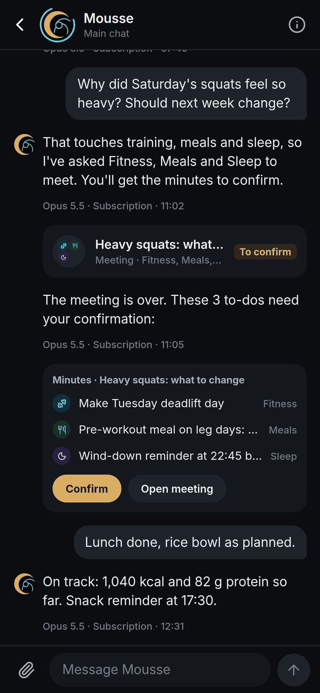
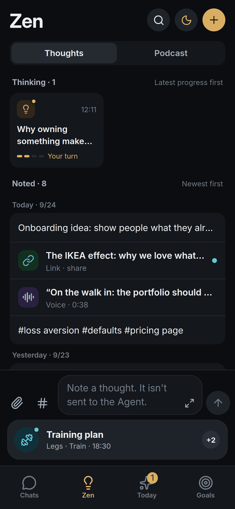

<p align="center">
  <picture>
    <source media="(prefers-color-scheme: dark)" srcset="docs/brand/banner-dark.png">
    
  </picture>
</p>

<p align="center">
  <a href="README.zh-CN.md">中文</a> · <strong>English</strong> · <a href="https://openmousse.ai">openmousse.ai</a> · <a href="https://openmousse.ai/docs/welcome.html">Docs</a>
</p>

## Liquid Intelligence, Shaped by You.

The Living Medium Between You and AI.
The next-generation personal OS where human intuition and autonomous agents converge into a single, living continuum.

---

**Models are converging. How you see the world is not.** Foundation models are converging; what sets your AI apart is the personal context you build over time, kept on your server and distilled into a memory tree that belongs to you.

## What it is

OpenMousse is an open-source personal AI agent system that runs on your own server on top of a claw (an agent runtime: OpenClaw by default, with presets for Hermes, nanobot, and Letta, or any agent with an OpenAI-compatible API; a built-in engine where you just pick a model is coming soon), with clients for iPhone (TestFlight invitation), Android (APK), web (`npm run web:build` in `app/`, needs Node.js), and a desktop workspace (coming soon).

- **Memory tree.** One long-term memory on your server (SQLite, or Markdown notes in any folder, which a notes app such as Obsidian can open), where facts, preferences, decisions, and mature views become leaves carrying their source. Uncertain items can wait for your approval. Claude, ChatGPT, Gemini, Notion, and Claude Code connect over MCP with five tools (`profile`, `recall`, `remember`, `recent`, `forget`) without touching raw data; it also runs standalone as `mousse-tree` (`tree/`).
- **Three kinds of agents.** Main chat is the entry point: it hands work to functional agents and can call short meetings whose minutes wait for your confirmation. Each functional agent looks after one area with its own chat, memory, tools, and board (table, kanban, calendar, timeline, and chart views); after install there are none, and you create them by asking in chat ("make me an Agent for sleep"). Cybers, thinking partners with their own persona, are coming soon.
- **Ask first.** Connector writes (such as to Notion) wait for your approval, and everything your card agent says to friends is reviewed by Doorman before it goes out. The Errands sandbox, where passwords stay with Doorman as placeholders, is a preview you enable with `python3 server/errand.py setup` (needs Docker). Enforced three-tier tool permissions come with the built-in engine (coming soon).
- **Friends and card agent (the Butler coming soon).** Friends connect by mutual invite; messages are signed, and end-to-end encrypted between current versions (without a public address they pass through the OpenMousse relay, which stores nothing). Your card agent answers friends within the relationship tier you set; its successor, the Butler, is coming soon.
- **Zen and podcasts.** Notes in Zen are not sent to any AI until you tap Discuss or Write up; when you finish thinking, you save a note to the vault and mature views grow into the memory tree. Podcasts let you record with friends around one phone for a speaker-separated transcript and minutes.
- **Today.** Three blocks: To do, Schedule, and Reports (sleep, morning report). At 03:45 the day is settled; at 04:00 chats start fresh while what matters is kept in memory.

<p align="center">
  
  
  
</p>

## Quick start

**What you need.** A Linux, macOS, or Windows (WSL 2) machine that stays on, with a claw running (for OpenClaw: a model configured and Gateway running), plus Python 3.11+, `git`, and `curl`.

**Install.** Run one command:

```bash
curl -fsSL https://openmousse.ai/install | bash
```

**What it asks.** The installer asks which claw to use (press Enter for OpenClaw, or choose `hermes`, `nanobot`, `letta`, or the OpenAI-compatible URL of another agent; the built-in engine is coming soon). It also asks for your language, your timezone, and the assistant's name, followed by two optional settings: a notes folder already synced to this server (an Obsidian vault, for example), and whether to open public HTTPS through Tailscale Funnel (so Claude.ai, ChatGPT, and other MCP clients can reach the memory tree, shares get links, and friends can reach you; only those paths are opened, never the app's API). Running the installer again is safe.

**Connect your phone.** Everything installs under `~/.openmousse`, the server starts, and the terminal prints a one-time pairing link valid for 10 minutes alongside the server address and code.

**Or let your agent install it.** Send your agent:

```text
Follow https://raw.githubusercontent.com/openmousse/openmousse/main/docs/connect.md to connect me to OpenMousse
```

**Check status.** Verify your setup at any time:

```bash
bash ~/openmousse/check.sh
```

## Docs and data

Conversations, memory, and health data stay on your server, and model calls use your own accounts. What leaves the server by design is listed in Data and Security and the Privacy Policy.

- [Documentation](https://openmousse.ai/docs/welcome.html)
- [llms.txt for agents](https://openmousse.ai/llms.txt) (every doc page also has a Markdown version at `/docs/<page>.md`)
- [Data and Security](https://openmousse.ai/docs/security.html)
- [Privacy Policy](https://openmousse.ai/privacy.html)

## Repository

| Folder | Description |
| :--- | :--- |
| `tree/` | The memory tree (`mousse-tree`), an MCP server |
| `app/` | The iPhone, Android, and web client (Expo) |
| `server/` | The server (FastAPI) |
| `packs/` | Core skills and the installer's setup, plus optional feature packs |
| `relay/` | The friends relay (Cloudflare) |
| `docs/` | Agent install guide, friend and agent protocols |

## Contributing

See [CONTRIBUTING.md](CONTRIBUTING.md); install reports and data-source adapters help most.

## License

AGPL-3.0, © 2026 Leo Zhou. Free to run, study, change, and share; if you offer a changed version to others over a network, publish your changes under the same license. For commercial licenses, open a GitHub issue. Versions before 28 September 2026 (up to commit `b8902a8`) remain MIT; Expo template code in `app/` keeps its MIT notice (`app/LICENSE-EXPO`).
