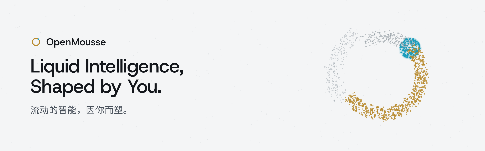
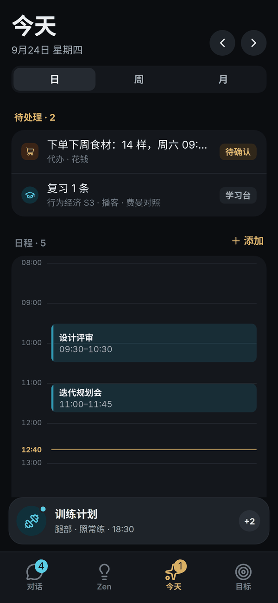
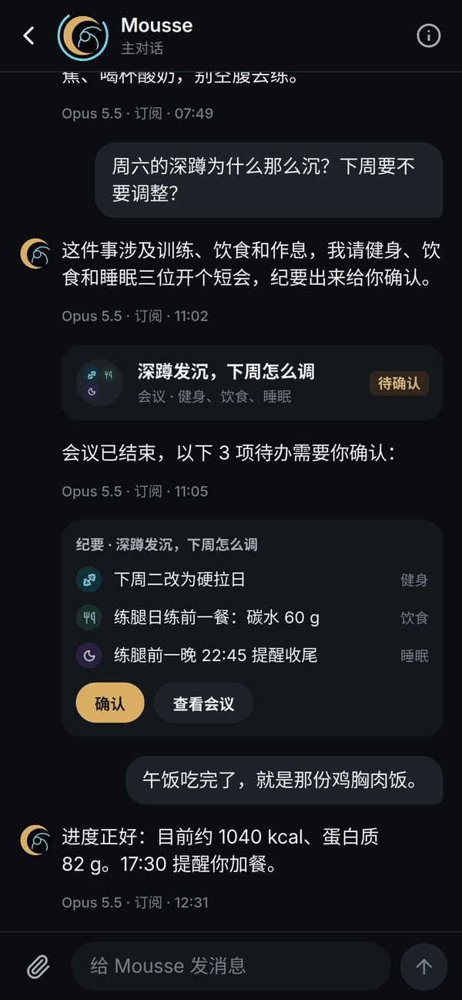
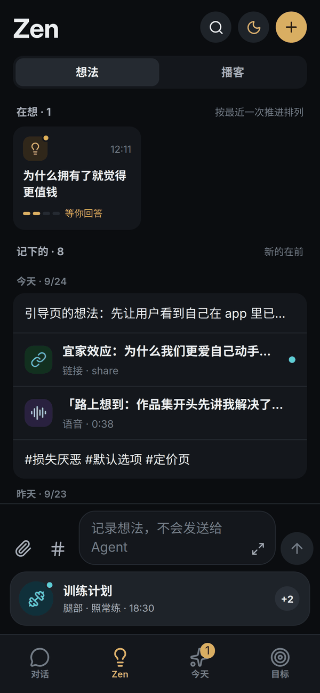

<p align="center">
  <picture>
    <source media="(prefers-color-scheme: dark)" srcset="docs/brand/banner-dark.png">
    
  </picture>
</p>

<p align="center">
  <strong>中文</strong> · <a href="README.md">English</a> · <a href="https://openmousse.ai">openmousse.ai</a> · <a href="https://openmousse.ai/docs/welcome.html">文档</a>
</p>

## 流动的智能，因你而塑。

横亘于你与万千 AI 之间的新介质——下一代个人操作系统：让人类的直觉与自治 Agent 生态，坍缩为一个与你共生的数字连续体。

---

**模型趋于同质，唯独你看待世界的方式不会。** 基础模型趋于同质化，真正构成差异的是日积月累的个人上下文：工作与生活的上下文留在你的服务器上，从中提炼的事实、偏好、决定与成熟观点，生长为一棵属于你的世界树。

## 这是什么

OpenMousse 是运行在你自己服务器上的开源个人 AI Agent 系统，当前运行在 claw（Agent 运行时：默认为 OpenClaw，内置 Hermes、nanobot 与 Letta 预设，也支持任何提供 OpenAI 兼容接口的 Agent）之上，直接选模型即可使用的内置引擎（即将推出）；提供 iPhone（TestFlight 邀请）、Android（APK）、网页端（在 `app/` 下执行 `npm run web:build`，需 Node.js）以及桌面工作台（即将推出）。

- **世界树。** 服务器上的统一长期记忆（SQLite，或任意文件夹里的 Markdown 笔记，可以用 Obsidian 这类笔记软件打开），事实、偏好、决定与推敲成熟的观点都成为带有出处的叶子，拿不准的可以先进「待确认」。Claude、ChatGPT、Gemini、Notion 与 Claude Code 通过 MCP 的五个工具（`profile`、`recall`、`remember`、`recent`、`forget`）授权读写，触及不到原始数据；也可作为 `mousse-tree`（`tree/`）独立运行。
- **三类 Agent。** 主对话是入口，负责把工作交给功能 Agent，也能召集简短会议并生成待你确认的纪要。每个功能 Agent 照看一个领域，拥有独立的对话、记忆、工具与看板（表格、看板、日历、时间线与图表视图）；安装后默认为空，在对话中提出需求（如「帮我建一个管睡眠的 Agent」）即可创建。拥有独立人格的思考伙伴「赛博」（即将推出）。
- **先问你。** 连接器的写入操作（例如写入 Notion）需等待你的批准；名片 Agent 对好友说的每一句话，发出前都经由 Doorman 审核。密码以占位符形式留在 Doorman 处的代办沙箱目前为预览功能，可通过 `python3 server/errand.py setup` 开启（需 Docker）。由系统强制执行的三档工具权限将随内置引擎（即将推出）提供。
- **好友与名片 Agent。** 好友通过双向邀请连接，消息带有签名，当前版本间端到端加密；无公网地址时经由不存储任何内容的 OpenMousse 中继转发。名片 Agent 在你设定的关系层级内回应好友；其继任者「管家」（即将推出）。
- **Zen 与播客。** 在 Zen 中记录的想法，点击「讨论」或「写成笔记」前不会发给任何 AI；思考完成后可点击「保存到库」存为笔记，成熟的观点汇入世界树。播客支持与好友围坐一部手机录音，生成区分说话人的逐字稿与纪要。
- **今天。** 包含「待处理」「日程」「报告」（睡眠、起床报告）三个板块。凌晨 03:45 日结、04:00 对话翻篇，重要内容留入记忆。

<p align="center">
  
  
  
</p>

## 快速开始

**准备条件。** 一台保持开机的 Linux、macOS 或 Windows（WSL 2）设备，已运行 claw（若用 OpenClaw，需配置好模型并启动 Gateway），并装有 Python 3.11+、`git` 与 `curl`。

**安装。** 执行以下命令：

```bash
curl -fsSL https://openmousse.ai/install | bash
```

**安装问答。** 安装脚本会询问使用哪个 claw（直接回车使用 OpenClaw，或输入 `hermes`、`nanobot`、`letta`，或其他 Agent 的 OpenAI 兼容地址），内置引擎（即将推出），随后询问语言、时区和助手名字，以及两个可选项：已同步到该服务器的笔记文件夹（例如 Obsidian 库），和是否通过 Tailscale Funnel 开启公网 HTTPS（开启后 Claude.ai、ChatGPT 等 MCP 客户端可连接世界树、分享可生成链接、好友可直连；仅开放上述路径，绝不暴露应用 API）。重复运行该命令是安全的。

**连接手机。** 所有文件安装在 `~/.openmousse` 下，服务启动后终端会打印有效期 10 分钟的一次性配对链接，以及服务器地址与配对码。

**或让 Agent 代为安装。** 发给你的 Agent：

```text
按 https://raw.githubusercontent.com/openmousse/openmousse/main/docs/connect.zh-CN.md 把我接上 OpenMousse
```

**自检。** 随时检查运行状态：

```bash
bash ~/openmousse/check.sh
```

## 文档与数据

对话、记忆与健康数据留在你的服务器上，模型调用使用你自己的账号。设计上会离开服务器的数据均列于《数据与安全》及《隐私政策》。

- [文档](https://openmousse.ai/docs/welcome.html)
- [供 Agent 阅读的 llms.txt](https://openmousse.ai/llms.txt)（每个文档页面均提供 `/docs/<page>.md` 的 Markdown 版本）
- [数据与安全](https://openmousse.ai/docs/security.html)
- [隐私政策](https://openmousse.ai/privacy.html)

## 代码仓库

| 目录 | 说明 |
| :--- | :--- |
| `tree/` | 世界树（`mousse-tree`），MCP 服务器 |
| `app/` | iPhone、Android 与网页客户端（Expo） |
| `server/` | 服务端（FastAPI） |
| `packs/` | 核心技能与安装配置，以及可选功能包 |
| `relay/` | 好友消息中继（Cloudflare） |
| `docs/` | Agent 安装指南、好友与 Agent 协议 |

## 参与贡献

详见 [CONTRIBUTING.md](CONTRIBUTING.md)；安装反馈与数据源适配器对项目帮助最大。

## 许可证

AGPL-3.0，© 2026 Leo Zhou。可自由运行、研究、修改与分发；若通过网络向他人提供修改后的版本，须以相同许可证公开你的修改。商业授权请提交 GitHub issue。2026 年 9 月 28 日之前的版本（至提交 `b8902a8`）仍为 MIT；`app/` 中的 Expo 模板代码保留其 MIT 声明（`app/LICENSE-EXPO`）。
